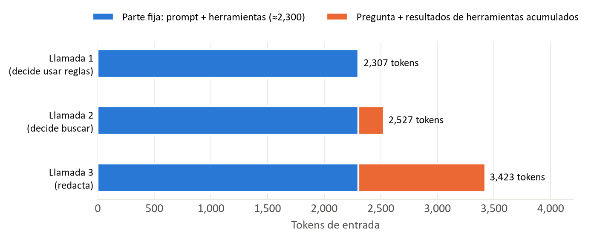
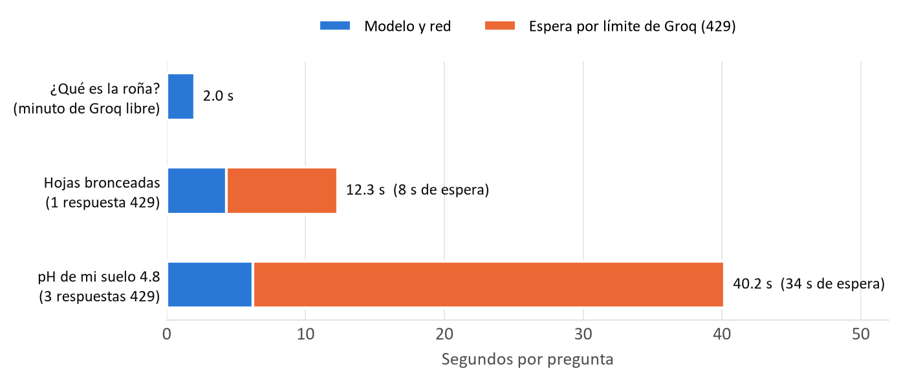
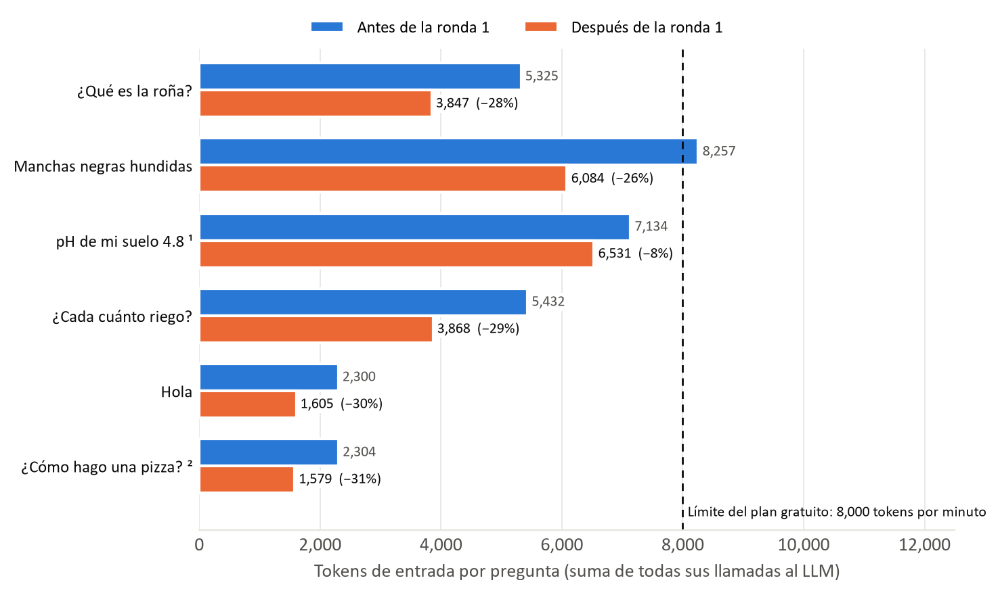
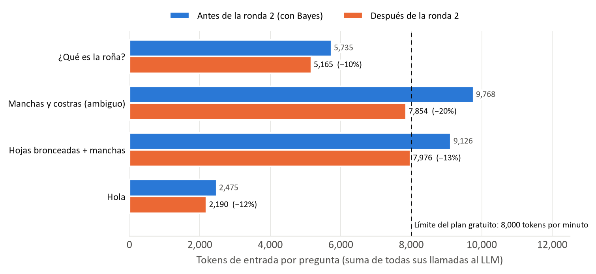
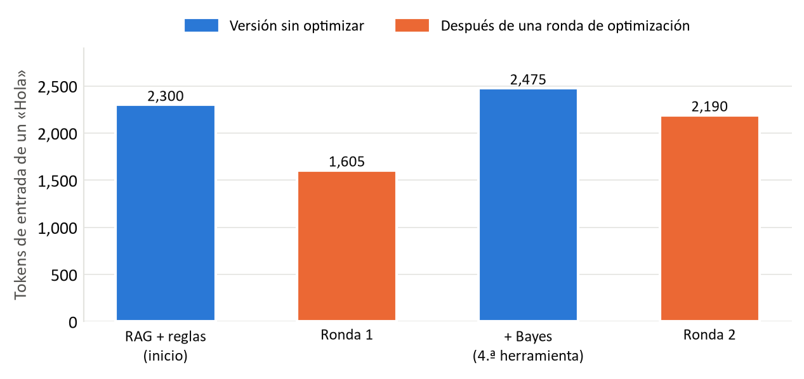

# AgroIA — Optimización del consumo de tokens del agente

**Equipo:** Isis Lizbeth Vázquez Ávalos · Danna Geraldine Ávila García · Yatziri Jacqueline García Sánchez · Bryan Gael Esquivel Pérez
**Materia:** Inteligencia Artificial · Tecnológico Nacional de México, Campus Jiquilpan
**Fecha:** 8 de noviembre de 2026

## Resumen

El agente de AgroIA responde con herramientas (búsqueda en la base de conocimiento, reglas y Teorema de Bayes), y por eso cada pregunta técnica hace 2 o 3 llamadas al modelo y reenvía todo el contexto en cada una. Con el plan gratuito de Groq eso chocaba con el límite de 8,000 tokens por minuto y provocaba esperas de hasta 65 s. En dos rondas de optimización bajamos el consumo por pregunta entre 26 % y 31 % en la mayoría de las preguntas (ronda 1) y entre 10 % y 20 % adicional (ronda 2), sin perder calidad en las respuestas. El límite diario de Groq no se resuelve recortando y queda como decisión para el despliegue.

Todos los números de este documento son mediciones reales del servicio (Groq `openai/gpt-oss-120b` + pgvector), tomadas en las ramas `perf/optimizar-tokens` (2 de noviembre de 2026, PR #13) y `perf/optimizar-final` (8 de noviembre de 2026, PR #16). Los gráficos se generan con [`scripts/graficos_optimizacion_tokens.py`](scripts/graficos_optimizacion_tokens.py).

## 1. Contexto y decisiones de diseño

El agente vive en `svc-agente` (Python 3.12, FastAPI) y se construye con LangChain (`langchain==1.4.7`, `langchain-core==1.7.0`) usando `create_agent`. El modelo es `openai/gpt-oss-120b`, servido por Groq (`langchain-groq==1.1.3`). Tiene cuatro herramientas, y cada una existe por una razón:

| Herramienta | Técnica | Para qué |
|---|---|---|
| `buscar_conocimiento` | RAG sobre PostgreSQL + pgvector, embeddings locales `intfloat/multilingual-e5-small` | Que el agente **no invente**: responde con fragmentos de una base de conocimiento de 11 documentos y **cita las fuentes** |
| `diagnosticar_sintomas` | Sistema basado en reglas (SBR) | Decisiones **deterministas** «SI… ENTONCES…» cuando el síntoma es claro |
| `evaluar_huerto` | Sistema basado en reglas (SBR) | Clasificar parámetros del huerto (pH, tipo de suelo, encharcamiento, edad de los árboles) |
| `estimar_probabilidades_sintomas` | Teorema de Bayes | Expresar la **incertidumbre** cuando hay varios síntomas o son ambiguos («roña 79 %, antracnosis 13 %») |

Estas técnicas son las que pide la materia: un agente que razona con reglas, con probabilidad y con conocimiento recuperado. El costo en tokens es la consecuencia natural de un agente con herramientas, no un error de diseño. Lo que sí se podía mejorar es cuánto contexto se manda en cada llamada.

## 2. Por qué una pregunta consume tantos tokens

Un agente con herramientas (*tool-calling*) no responde en una sola llamada. El modelo trabaja en ciclo:

1. Lee la pregunta y **decide** si necesita una herramienta.
2. El sistema ejecuta la herramienta y le **devuelve el resultado**.
3. El modelo vuelve a decidir: otra herramienta o la respuesta final.

Además, el modelo **no tiene estado**: no recuerda la llamada anterior. Por eso en **cada** llamada se reenvía todo:

- el *prompt* del sistema (las instrucciones y los límites del agente),
- los esquemas de las cuatro herramientas (incluido el catálogo de síntomas),
- el historial de la conversación,
- los resultados de las herramientas anteriores (por ejemplo, los fragmentos del RAG).

**Ejemplo real** (2 de noviembre, antes de optimizar), con la pregunta «Tengo manchas negras hundidas en el fruto»:

| Llamada | Qué recibe el modelo | Qué decide | Tokens de entrada / salida |
|---|---|---|---|
| 1 | Prompt + herramientas + pregunta | Usar `diagnosticar_sintomas` | 2,307 / 116 |
| 2 | Lo anterior + resultado de las reglas («antracnosis probable») | Usar `buscar_conocimiento` | 2,527 / 99 |
| 3 | Lo anterior + 4 fragmentos del RAG | Redactar la respuesta con sus fuentes | 3,423 / 339 |
| **Total** | | | **8,257 / 554** |



*La parte fija (prompt + herramientas, unos 2,300 tokens: lo mismo que mide un «Hola») se paga en las tres llamadas. Lo que crece de una llamada a otra son los resultados de las herramientas.*

## 3. Los problemas medidos

Groq informa sus límites en los encabezados de cada respuesta y en los errores 429:

- **Límite por minuto: 8,000 tokens/min.** Una pregunta técnica gastaba entre 5,325 y 8,257 tokens de entrada: casi el límite completo. Si llegan dos preguntas en el mismo minuto, Groq responde 429 y el cliente reintenta tras esperar de 3 a 23 s. Medimos preguntas de 37 a 65 s en total; en una ráfaga de 4 preguntas seguidas, la cuarta recibió dos 429 y tardó 24.7 s.
- **Límite diario: 200,000 tokens/día.** Lo alcanzamos durante las mediciones («Used 199,555»). A partir de ahí cada pregunta falla en menos de un segundo con 503, porque la espera que pide Groq (unos 9.5 min) es demasiado larga para reintentar. Con las cifras de la ronda 1 eso alcanzaba para unas 30–50 preguntas técnicas al día en toda la aplicación; con las cifras actuales (5,000–8,000 tokens de entrada por pregunta técnica) son unas 25–40.
- **La latencia del modelo es baja.** Cada llamada tarda de 0.7 a 1.4 s, y una pregunta completa de 0.5 a 5 s con el minuto libre. Lo que dispara el tiempo son las esperas por el límite, no el modelo:



*En «pH de mi suelo 4.8», 34 de los 40.2 s fueron esperas anunciadas por el cliente de Groq tras tres respuestas 429 (3 + 8 + 23 s).*

- **El prompt caching de Groq no lo resuelve** (lo verificamos con pruebas propias). Groq cachea automáticamente el inicio del prompt con `gpt-oss-120b`, incluso en el plan gratuito, y cuando acierta la llamada descuenta del límite por minuto solo unos 250 tokens en lugar de unos 2,000. Pero:
  - es **intermitente**: de 18 solicitudes idénticas, 7 cachearon 2,048 tokens, 6 solo 512 y 5 nada;
  - Groq **decide si acepta** la solicitud según el prompt completo, cacheado o no (el error decía «Requested 2,369» para un prompt de 2,309 tokens más 60 de salida).

  Ayuda un poco, pero no evita los 429 ni el límite diario. Por eso, además, había que mandar menos tokens.

## 4. Las optimizaciones aplicadas

### Ronda 1: prompt y herramientas más cortos (PR #13)

Sin cambiar la lógica del agente, del RAG ni de las reglas:

| Pieza | Antes | Después | Archivo |
|---|---|---|---|
| Prompt del sistema | 4,198 caracteres | 2,737 (−35 %) | `app/prompt.py` |
| Descripciones de herramientas y catálogo de síntomas | ~5,200 caracteres | ~3,750 (−28 %) | `app/tools.py`, `app/reglas.py` |
| Fragmentos del RAG | repetían título y sección | una sola vez | `app/tools.py` |
| **Contexto fijo por llamada** | **~2,300 tokens** | **~1,600 tokens** | |

Se quitaron redundancias y texto de más, **no reglas**: siguen la búsqueda obligatoria, no inventar, no dar dosis, los límites de seguridad y la línea de fuentes.



| Pregunta | Antes: tokens · llamadas · tiempo | Después: tokens · llamadas · tiempo | Cambio |
|---|---|---|---|
| ¿Qué es la roña? | 5,325 · 2 · 2.0 s | 3,847 · 2 · 1.5 s | −28 % |
| Manchas negras hundidas | 8,257 · 3 · 2.9 s | 6,084 · 3 · 3.1 s | −26 % |
| pH de mi suelo 4.8 ¹ | 7,134 · 2 · 1.6 s | 6,531 · 3 · 3.2 s | −8 % |
| ¿Cada cuánto riego? | 5,432 · 2 · 2.0 s | 3,868 · 2 · 2.0 s | −29 % |
| Hola | 2,300 · 1 · 0.7 s | 1,605 · 1 · 3.8 s | −30 % |
| ¿Cómo hago una pizza? ² | 2,304 · 1 · 0.7 s | 1,579 · 1 · 0.6 s | −31 % |

*Cada pregunta, con el minuto de Groq libre; ninguna recibió 429. ¹ Después usa las dos herramientas que pide el prompt (antes se saltaba una), por eso hace una llamada más. ² Medida en la corrida con `RAG_TOP_K=3`; para esta pregunta da igual porque no usa el RAG. La ráfaga «después» no se pudo medir porque se agotó el límite diario.*

### Ronda 2: catálogo una vez, *content_and_artifact*, fuentes y etiquetas (PR #16)

Al agregar Bayes como cuarta herramienta, el contexto fijo volvió a subir, a unos 2,475 tokens. El principal culpable: el catálogo completo de síntomas viajaba en el esquema de **dos** herramientas (reglas y Bayes). La ronda 2 aplicó cuatro cambios:

1. **Catálogo de síntomas una sola vez** (`app/tools.py`). Las dos herramientas siguen aceptando los mismos códigos, porque eso impide que el modelo invente códigos. Pero la descripción de cada síntoma solo va en el esquema de Bayes, y `diagnosticar_sintomas` remite a él.
2. **Técnica *content_and_artifact* en reglas y Bayes** (`app/tools.py`), explicada abajo.
3. **Fuentes sin duplicados y con tope** (`app/agent.py`). Se unifica la misma obra escrita distinto en dos documentos (mismo autor y año). Si el modelo no escribe la línea `FUENTES`, se toman solo los 2 documentos más relevantes de cada búsqueda. En el caso de hojas bajaron de 12 fuentes a 8, sin repetidas.
4. **Limpieza de etiquetas** (`app/agent.py` y `app/prompt.py`). Se quitan del texto final etiquetas como `[enfermedades/rona.md]` o `【…】` que el modelo a veces copiaba (3 en una respuesta antes, 0 después).



| Pregunta | Antes: contexto fijo · total · llamadas | Después: contexto fijo · total · llamadas | Cambio |
|---|---|---|---|
| ¿Qué es la roña? | 2,484 · 5,735 · 2 | 2,199 · 5,165 · 2 | −10 % |
| Manchas y costras (ambiguo) | 2,483 · 9,768 · 3 | 2,198 · 7,854 · 3 | −20 % |
| Hojas bronceadas + manchas | 2,494 · 9,126 · 3 | 2,209 · 7,976 · 3 | −13 % |
| Hola | 2,475 · 2,475 · 1 | 2,190 · 2,190 · 1 | −12 % |

*Contexto fijo = tokens de entrada de la primera llamada. Bajó un 11 % en tokens (de 2,484 a 2,199) y un 10 % en caracteres de prompt y esquemas (de 9,811 a 8,843). Todas las mediciones «después» son de la configuración final.*

La evolución del contexto fijo en todo el proyecto, medida con un «Hola» (una sola llamada, sin herramientas):



*Cada herramienta nueva agrega contexto; cada ronda lo recorta. Bayes sumó unos 870 tokens por llamada, y la ronda 2 recuperó unos 285.*

### La técnica *content_and_artifact*

En LangChain una herramienta puede devolver dos cosas: el **contenido**, que es lo que lee el modelo, y el **artifact**, que queda guardado en el mensaje de la herramienta pero **no se envía al modelo**. El RAG ya la usaba (el modelo lee los fragmentos y las fuentes viajan en el artifact). En la ronda 2 la aplicamos a las reglas y a Bayes.

Ejemplo real con «Tengo manchas en el fruto y algunas costras». **Lo que ve el modelo** (645 caracteres; antes eran 911):

```text
Teorema de Bayes, P(causa|sintomas), valores orientativos:
- Roña del aguacate (Elsinoë perseae / Sphaceloma perseae): 79%
- Antracnosis (hongos del género Colletotrichum): 13%
- Daño por trips: 8%
Veredicto: Hay una causa mas probable, pero no es concluyente.
Cita cada porcentaje con su causa, tal cual; las causas que no estan aqui no tienen porcentaje.
Para explicar la causa principal, busca en la base de conocimiento (enfermedades/rona.md).
- Hay una causa mas probable, pero no es concluyente: conviene confirmarla.
Probabilidades orientativas, no un diagnostico. Orientativo: confirma con un tecnico. No des dosis, productos ni recetas.
```

**Lo que va en el artifact** (el cálculo bayesiano completo, que el modelo no necesita para redactar; extracto):

```json
{
  "sintomas": ["costras_corchosas_levantadas", "fruto_manchas_sin_detalle"],
  "evidencia_P(S)": 0.1257,
  "veredicto": "probable",
  "terminos": [
    {"causa": "rona", "prior_P(C)": 0.1579, "verosimilitud_P(S|C)": 0.63,
     "numerador_P(S|C)P(C)": 0.0995, "posterior_P(C|S)": 0.7912},
    {"causa": "antracnosis", "prior_P(C)": 0.1579, "verosimilitud_P(S|C)": 0.105,
     "numerador_P(S|C)P(C)": 0.0166, "posterior_P(C|S)": 0.1319}
  ]
}
```

El modelo recibe solo lo que necesita para responder (las probabilidades, el veredicto y los avisos). El detalle se conserva para revisar o mostrar el cálculo, sin costar tokens en cada llamada.

## 5. Decisiones de ingeniería: lo que no hicimos y por qué

Optimizar no es recortar todo. Cada recorte se midió con respuestas reales, y los que empeoraban la calidad no se aplicaron:

- **No bajamos `RAG_TOP_K` de 4 a 3.** Ahorraba tokens y el documento correcto seguía en los 3 primeros fragmentos en 10 de 10 preguntas. Pero en 7 de 10 casos el 4.º fragmento era otra sección útil del mismo documento. Con k=3, «¿Qué plaga se mete en el hueso?» perdió los síntomas (perforaciones, exudado, aserrín) y «¿Cada cuánto riego?» perdió la sección «Cuándo regar».
- **Revertimos un recorte del 17 %.** Dejar solo los códigos de síntomas, sin sus descripciones, bajaba el contexto fijo 17 % en lugar de 11 %. Pero en 2 de 3 corridas el modelo omitió «caída de hojas», que el productor sí había mencionado, y Bayes daba trips 80 % en lugar de araña roja 34 % (no concluyente). Con las descripciones una sola vez, la extracción fue correcta en los 4 intentos que se completaron (un quinto falló por un error de Groq, ver el final).
- **Corregimos una regresión.** Con la salida de Bayes más corta, el modelo dejó de consultar la base de conocimiento y solo daba números. Volvimos a indicarle qué documento explica la causa principal (unos 15 tokens), y volvió a fundamentar la respuesta con fuentes.
- **No unificamos reglas y Bayes en una sola herramienta.** Ahorraría un esquema completo, pero son dos técnicas distintas que conviene mostrar por separado, y combinar sus resultados (que a veces dicen cosas distintas) complicaría la respuesta.

## 6. Lo que la optimización no resuelve y opciones a futuro

**El límite diario de Groq no se quita recortando.** Aun con todas las optimizaciones, una pregunta técnica cuesta 5,000–8,000 tokens de entrada, y el plan gratuito alcanza para unas 25–40 preguntas técnicas al día en toda la aplicación. Las opciones:

- **Plan de pago de Groq (Dev Tier):** quita el cuello de botella sin tocar código. Habría que revisar sus límites y su costo actuales.
- **Otro proveedor con un plan gratuito más amplio** (por ejemplo, Gemini): habría que verificar que el *tool-calling* sea confiable con nuestras herramientas, la latencia y sus límites actuales, que no hemos medido. La arquitectura lo permite: el modelo se configura por variables de entorno (`LLM_MODEL`, `LLM_TIMEOUT`, `LLM_MAX_RETRIES`) y se crea en una sola función (`build_llm()` en `app/agent.py`), y el RAG usa la interfaz `VectorStore` de LangChain.

Técnicas de la industria y si aplican a nuestra etapa:

| Técnica | ¿Aplica ahora? | Comentario |
|---|---|---|
| Prompt caching | Sí, ya activo | Groq lo aplica solo; mantenemos la parte estable al inicio del prompt. Ayuda, pero es intermitente |
| Recorte de prompt y esquemas | Sí, hecho | Dos rondas, medidas con respuestas reales |
| *content_and_artifact* | Sí, hecho | En el RAG, las reglas y Bayes |
| Límites de contexto | Sí, parcial | Historial máximo de 50 mensajes y `RAG_TOP_K=4` |
| Resumen del historial | Más adelante | Útil con conversaciones largas; hoy casi todas las preguntas son cortas |
| Enrutar con un modelo pequeño | Sobre-ingeniería por ahora | Por ejemplo, `gpt-oss-20b` para saludos. Agrega otro modelo que validar, a cambio de poco ahorro en esta etapa |

**Decisión:** para la demo y la entrega académica, el plan gratuito alcanza si se respetan sus límites (preguntas espaciadas y un volumen bajo). La decisión de plan o proveedor para producción se tomará en el despliegue (Entrega 4), con estas mediciones como base.

## 7. Conclusión

**Qué se logró:**

- Menos tokens por pregunta: −26 % a −31 % en la ronda 1 (−8 % en la pregunta del pH, que ahora usa dos herramientas), y −10 % a −20 % en la ronda 2 después de agregar Bayes.
- Calidad mantenida, verificada con respuestas reales en cada ronda: la roña sigue correcta y con fuentes, las probabilidades se citan bien, el caso ambiguo sigue «no concluyente» y el saludo no usa herramientas.
- Respuestas más limpias: sin etiquetas visibles y sin fuentes duplicadas.
- El cálculo bayesiano completo se conserva en el artifact, disponible para revisarlo sin que cueste tokens.

**Qué queda pendiente:**

- El límite diario de Groq, que depende del plan o del proveedor (Entrega 4).
- En ráfagas de preguntas seguirá habiendo esperas por 429: una sola pregunta técnica ocupa la mayor parte de los 8,000 tokens por minuto.
- En 1 de unas 15 llamadas de la última medición Groq respondió `BadRequestError` y `/chat` devolvió 503. No se pudo reproducir; si se vuelve frecuente, se puede reintentar ese error una vez.

## Datos y reproducción

- Mediciones: servicio real con Groq y pgvector, cada pregunta con el minuto de Groq libre salvo donde se indica.
- Gráficos: `pip install matplotlib` y, desde la raíz del repositorio, `python docs/scripts/graficos_optimizacion_tokens.py`. El script deja los PNG en `docs/img/`; cada bloque de datos indica la medición de la que sale.
